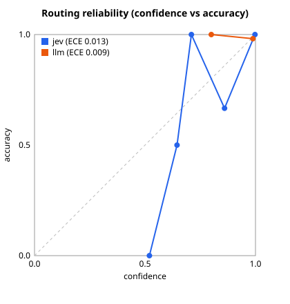

# Routing evaluation report

Dataset: `../data/applications.jsonl`

## Gate comparison (gold segments)

| Router | Segments | Accuracy | Macro F1 | Mean conf. | ECE ↓ | Brier ↓ | Auto-routed | Accuracy when auto-routed | Errors caught by gate | Errors missed |
|---|---:|---:|---:|---:|---:|---:|---:|---:|---:|---:|
| jev | 160 | 98.1% | 0.953 | 0.986 | 0.013 | 0.011 | 100.0% | 98.1% | 0 | 3 |
| llm | 160 | 98.1% | 0.970 | 0.987 | 0.009 | 0.017 | 100.0% | 98.1% | 0 | 3 |

Gate threshold: 0.50

### Gate threshold sweep

Each cell: segments sent to human / wrong routes that slip through.

| τ | jev | llm |
|---:|---:|---:|
| 0.50 | 0 / 3 | 0 / 3 |
| 0.60 | 1 / 2 | 0 / 3 |
| 0.70 | 3 / 1 | 0 / 3 |
| 0.80 | 4 / 1 | 0 / 3 |
| 0.90 | 7 / 0 | 1 / 3 |
| 0.95 | 8 / 0 | 4 / 2 |
| 0.99 | 14 / 0 | 39 / 0 |

### jev: per-expert

| Expert | Precision | Recall | F1 | Support |
|---|---:|---:|---:|---:|
| medical | 0.952 | 1.000 | 0.976 | 40 |
| lifestyle | 1.000 | 1.000 | 1.000 | 20 |
| financial | 1.000 | 1.000 | 1.000 | 39 |
| coverage | 0.977 | 1.000 | 0.989 | 43 |
| compliance | 1.000 | 0.667 | 0.800 | 6 |
| other | 1.000 | 0.917 | 0.957 | 12 |

### jev: confusion matrix (rows = gold, cols = predicted)

| gold \ pred | medical | lifestyle | financial | coverage | compliance | other |
|---|---:|---:|---:|---:|---:|---:|
| **medical** | 40 | 0 | 0 | 0 | 0 | 0 |
| **lifestyle** | 0 | 20 | 0 | 0 | 0 | 0 |
| **financial** | 0 | 0 | 39 | 0 | 0 | 0 |
| **coverage** | 0 | 0 | 0 | 43 | 0 | 0 |
| **compliance** | 2 | 0 | 0 | 0 | 4 | 0 |
| **other** | 0 | 0 | 0 | 1 | 0 | 11 |

### jev: calibration

| Confidence bin | Count | Mean conf. | Accuracy |
|---|---:|---:|---:|
| 0.5–0.6 | 1 | 0.520 | 0.000 |
| 0.6–0.7 | 2 | 0.645 | 0.500 |
| 0.7–0.8 | 1 | 0.710 | 1.000 |
| 0.8–0.9 | 3 | 0.860 | 0.667 |
| 0.9–1.0 | 153 | 0.998 | 1.000 |

### llm: per-expert

| Expert | Precision | Recall | F1 | Support |
|---|---:|---:|---:|---:|
| medical | 0.976 | 1.000 | 0.988 | 40 |
| lifestyle | 1.000 | 1.000 | 1.000 | 20 |
| financial | 1.000 | 0.974 | 0.987 | 39 |
| coverage | 0.956 | 1.000 | 0.977 | 43 |
| compliance | 1.000 | 0.833 | 0.909 | 6 |
| other | 1.000 | 0.917 | 0.957 | 12 |

### llm: confusion matrix (rows = gold, cols = predicted)

| gold \ pred | medical | lifestyle | financial | coverage | compliance | other |
|---|---:|---:|---:|---:|---:|---:|
| **medical** | 40 | 0 | 0 | 0 | 0 | 0 |
| **lifestyle** | 0 | 20 | 0 | 0 | 0 | 0 |
| **financial** | 0 | 0 | 38 | 1 | 0 | 0 |
| **coverage** | 0 | 0 | 0 | 43 | 0 | 0 |
| **compliance** | 1 | 0 | 0 | 0 | 5 | 0 |
| **other** | 0 | 0 | 0 | 1 | 0 | 11 |

### llm: calibration

| Confidence bin | Count | Mean conf. | Accuracy |
|---|---:|---:|---:|
| 0.8–0.9 | 1 | 0.800 | 1.000 |
| 0.9–1.0 | 159 | 0.988 | 0.981 |

## End-to-end pipeline (router: jev)

| Metric | Value |
|---|---:|
| Applications | 40 |
| Pipeline failures | 0 |
| Gold segments | 160 |
| Segment recall (aligned) | 90.6% |
| Routing accuracy (end-to-end) | 88.8% |
| Decision agreement with labels | 27.5% |
| Fairness pairs consistent | 3/3 |

| Decision | Count |
|---|---:|
| refer_to_human | 40 |
